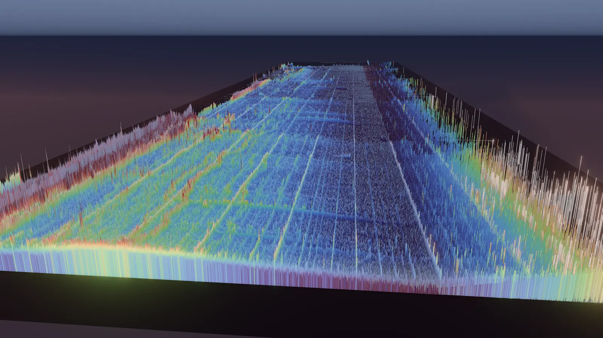
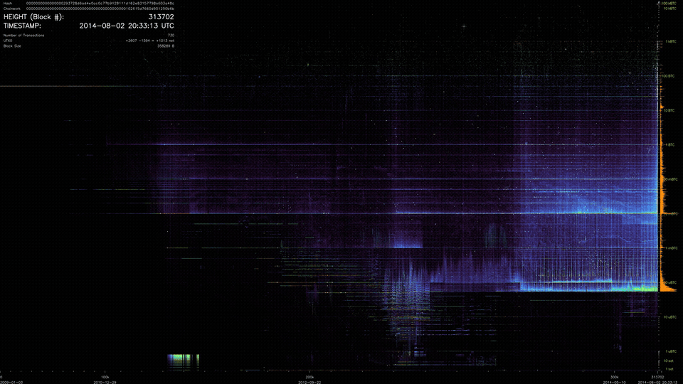
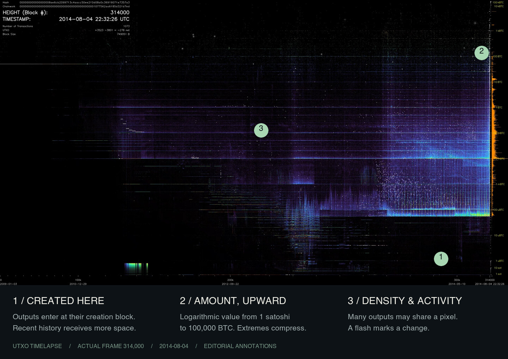
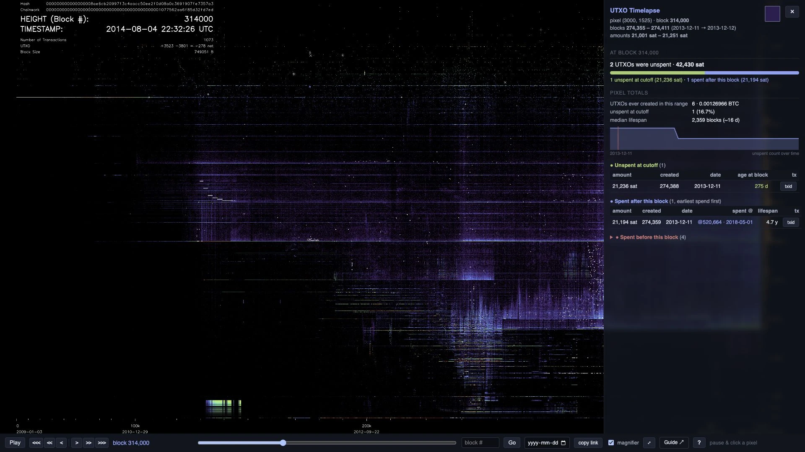
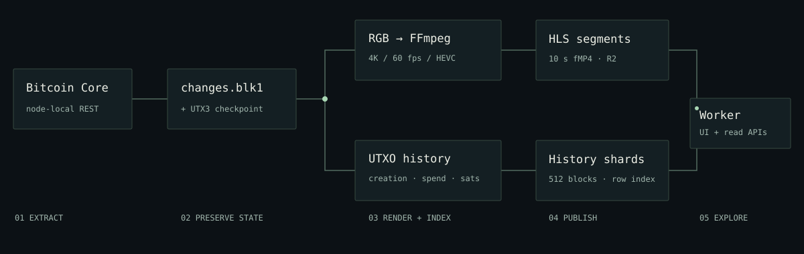

<div align="center">

# UTXO Timelapse

### Bitcoin's history, written in unspent outputs.

Every unspent output since the genesis block, rebuilt exactly from the chain and shown two ways:<br>
a 3D landscape you can fly through, and a 4K film you can pause on any block.

**[Explore Bitcoin Landscape](https://bitcoinlandscape.com/)** · **[Watch the 3-minute film](https://www.youtube.com/watch?v=99OAoD_ZVF0)** · **[Open the 2D explorer](https://bitcointimelapse.com/explorer)**

[](https://bitcoinlandscape.com/)

</div>

## Bitcoin Landscape

**[bitcoinlandscape.com](https://bitcoinlandscape.com/)** turns the unspent set into terrain. Creation block runs left to right, amount front to back, and the height and colour of each cell show what is still unspent there. Your browser replays the real chain to draw it, so every block you land on is the exact unspent set after that block.

- Fly over 17 years of outputs in map or flight mode, and play the chain block by block, from 30 blocks a second to as fast as your device can replay it.
- Click any cell to see its outputs, when each was created and spent, and its full history.
- Jump to landmarks such as the first 50 BTC rewards, the July 2015 flood or the dust ridge.
- Share a view or a single cell: the link opens at the same block and camera, at the quality of whoever opens it.

**[What remains](https://bitcoinlandscape.com/guide/)**, the landscape's guide, opens with a narrated three-minute film ([4K on YouTube](https://www.youtube.com/watch?v=99OAoD_ZVF0)) and walks through the shapes it shows. It runs best in a desktop browser with WebGPU; phones and WebGL2 browsers get a lighter quality automatically. [How the landscape works](docs/landscape.md) covers the data format, replay, rendering and deployment.

<div align="center">

## The 2D timelapse

[](https://nostitos.github.io/utxo-timelapse/)

**4K · 60 fps · one frame per block · 3.65 billion historical output records**<br>
Updated weekly, from genesis to the latest block.

**[Read the illustrated guide](https://bitcointimelapse.com/guide/)** · **[Open the explorer](https://bitcointimelapse.com/explorer)** · **[Under the hood](https://nostitos.github.io/utxo-timelapse/technical.html)**

</div>

## Learn to read the film

An output appears at its **creation block** on the horizontal axis and its **amount** on the vertical axis. It stays there until spent. Many outputs can share a pixel. Colour represents accumulated density, weighted by value in the film; a flash marks activity.

The newest 105,000-block epoch receives half the plot. Older epochs compress geometrically, with a 120-block slide at each layout change. Time is deliberately uneven: the present gets room while the past remains visible.

[](https://nostitos.github.io/utxo-timelapse/#reading)

The **[visual guide](https://nostitos.github.io/utxo-timelapse/)** walks through the axes, two palettes, eras, whale flashes and explorer controls with real frames, short films, enlarged crops and an interactive time-axis demonstration.

## Go from a picture to evidence

[](https://bitcointimelapse.com/explorer?block=314000&x=3000&y=1525)

**[Open this exact view](https://bitcointimelapse.com/explorer?block=314000&x=3000&y=1525).** At block 314,000, this pixel contains two unspent outputs. One was still unspent as of September 2026; the other was spent in 2018. The drawer shows amounts, dates, population over time and candidate transaction matches.

- Pause, magnify and inspect native image pixels.
- Jump by block or UTC date; step through individual frames.
- Separate outputs that are still unspent from those spent later or earlier.
- Share a block-and-pixel link; resolve candidate transaction IDs when needed.

The explorer streams a 1440p H.264 version of the film by default and offers the 4K HEVC 4:4:4 original where the browser can decode it. The guide's lighter previews work independently of the full film.

## Rendering and exploration

UTXO Timelapse combines chain processing, exact accounting, rendering, historical exploration and cloud delivery.

| Area | Implemented here |
|---|---|
| Time | Four axis modes, normalized geometric epochs and smooth boundary slides |
| Accounting | Double-precision density, exact remapping from an alive ledger, matching inverse pixel queries |
| Colour & activity | Amount-weighted density, actual-value flashes, a white-hot tail above 10 BTC, compressed extreme-value bands |
| Data | Creation-height-preserving v3 checkpoints, zero-value accounting, full historical lifecycle index and incremental updates |
| Exploration | Magnifier, historical pixel drawer, dates, block stepping, lifecycle charts, transaction matching and share links |
| Delivery | HEVC 4:4:4 film, segmented HLS, private R2 storage, Workers, indexed shards and later-spend patches |
| Updates | Verified prefix-preserving video append, continuous HLS timestamps and coordinated release metadata |

These choices have costs. Weighted colour is not a raw output count. Compressed time changes horizontal scale. Lossy previews can hide tiny points. The compact history does not retain full outpoints, so equal-amount transaction matches can be ambiguous. The **[technical reference](https://nostitos.github.io/utxo-timelapse/technical.html)** documents the formats, algorithms, API, all **42 settings**, measured release evidence and **20 tradeoffs**.

## Build your own

```sh
git clone --recurse-submodules https://github.com/nostitos/utxo-timelapse.git
cd utxo-timelapse
cmake -S . -B build -DCMAKE_BUILD_TYPE=Release
cmake --build build --parallel
./build/buv -ns '-tc=density_palette,epoch_transition_mapping,checkpoint_v3'
```

Requires a C++17 compiler, CMake, OpenCV and TBB. FFmpeg encodes the frames. Bitcoin Core and substantial storage/memory are needed to create your own dataset; generated chain files and the full video are not in Git. On macOS, see the tested build flags and test-suite caveat in **[the operations index](docs/README.md)**.



| Where to go | What you will find |
|---|---|
| [Bitcoin Landscape](https://bitcoinlandscape.com/) and [its guide](https://bitcoinlandscape.com/guide/) | The 3D landscape, the narrated film and a practical guide |
| [How the landscape works](docs/landscape.md) | Dataset format, browser replay, rendering, settings and deployment |
| [Illustrated guide](https://nostitos.github.io/utxo-timelapse/) | Learn the image, watch eras unfold, explore real screenshots |
| [Technical reference](https://nostitos.github.io/utxo-timelapse/technical.html) | Data formats, rendering math, settings, API and tradeoffs |
| [Operations index](docs/README.md) | Build, extract, render, update and publish |
| [Vocabulary](GLOSSARY.md) | Canonical terms tied to code |
| [September 10 release report](docs/video-update-2026-09-10.md) | Timings, retained bytes and verification evidence |
| [Cloud service](cloudflare/utxo-video-worker/README.md) | HLS, history shards, releases and deployment |
| [Guide source & media](site/README.md) | Static site, reproducible previews and provenance |

## Maintainer & license

UTXO Timelapse is maintained by **[nostitos](https://github.com/nostitos)**.

The [MIT license and copyright](LICENSE) are preserved. Upstream code acknowledgments, dependencies and font/media licenses are listed in the [technical credits](https://nostitos.github.io/utxo-timelapse/technical.html#credits).
