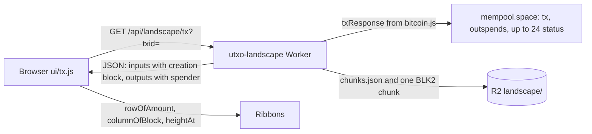

# Transaction view for the landscape: plan

Status: plan only, written 2026-11-18. No code is changed, nothing is deployed and nothing is published until the founder approves. The open choices are listed in [Decisions](#decisions).

The 2D explorer's transaction view (draft PR #80, branch `codex/trace-output`, not merged) draws a transaction on the film as lines into one point and out of it. This plan brings the same view to the landscape (`landscape/web`, bitcoinlandscape.com) and uses the third dimension and the camera for the cases the film cannot separate.

## Summary

- **Picture:** a transaction is a short **bridge** in the air above its block. Inputs rise from the cells of the coins it spent and gather at the past end of the bridge; outputs leave the future end, swing out over the empty side beyond the leading edge and land on the cells of the coins it made. Old coins arc higher than recent ones.
- **Data:** the landscape Worker answers `/api/landscape/tx` with PR #80's `txResponse`, imported the way it already imports `lifecycleJson`. The browser maps blocks and amounts to cells itself.
- **Rendering:** one instanced ribbon mesh, one draw call in the existing scene pass, no new render pass. It works on WebGPU and on the WebGL2 fallback.
- **Colour:** magenta inputs and white outputs over a black casing, as in 2D. On a light page (Paper) outputs turn to dark ink.
- **Phases:** 1 static view by txid and link; 2 inspector buttons, hops and sharing; 3 motion and following a coin; 4 owner labels, documentation and release.

## What was verified in the code

| Point from the brief | Finding |
|---|---|
| The x axis is linear | Yes. `x = block / 1000`, 64 blocks per L0 column, `z = row / 10` (`landscape/SPEC.md` §2, `web/data/grid.js`). Coins from the last 64 blocks share one column. |
| The browser already has the change log | Partly. The replay worker decodes BLK2 chunks (`web/replay/blk2.js`, `chunks.js`), but only those near the playback position, each about 4 MB. The dataset has no txid index, so the transaction's structure must come from a server. |
| The CSP limits `connect-src` to `'self'` | Yes (`contentSecurityPolicy` in `cloudflare/utxo-landscape-worker/src/index.js`). The browser cannot call mempool.space. |
| The landscape Worker imports video Worker code | Yes: `lifecycleJson`, `CONFIG`, `serveObject`. PR #80's `bitcoin.js` in turn imports `blk2.js` and the landscape release from the landscape side. |
| Tips differ | The history ends at `CONFIG.numBlocks - 1` (974,310). The landscape dataset ends at 974,621. `filmHeight` in PR #80 uses the film's tip, so the landscape needs its own tip passed in. |
| Entry points | The inspector lists outputs by creation block and amount without a txid, so its Trace button needs `/api/txid` first, as in 2D. The block field is `type="number"` (`web/ui/timeline.js`) and must accept text to take a txid. `hash.js` has a fixed list of shell keys. |
| Local runs | `serve.mjs` serves no API. The inspector asks the native explorer on port 12989, which answers `/api/tx` with 501 "Tracing is available in the online explorer" in PR #80. |
| Transparent overlays | `flashes.js` and the now plane are transparent meshes in the scene pass with `noGBufferWrites` (`web/render/gbuffer.js`), render orders 11 and 10. The ribbons follow that pattern at order 12. |
| Owners | `OwnerLedger` (`web/replay/owners.js`) holds exact records: creation block, spend block, amount, entity. An input or output can be matched on those three values. |

## Prototype

The design was tried before it was recommended. A page script injected ribbons into the running app (this branch's `landscape/web`, dataset `landscape_974621`, headless Chrome at 1600 × 900 through `landscape/tools/browser-check.mjs`) and took frames of real terrain. The transactions are PR #80's own answers from the local preview. The script and its inputs are in `/Users/t/.codex/visualizations/2026/11/18/01a1efe8-e7c7-7462-92fa-8481ca463195/prototype/`; the pictures are beside it and are not committed.

| Picture | What it shows |
|---|---|
| `shape-bridge-vs-hub.jpg` | The CoinJoin (224 → 270) and the 171 → 212 transaction, bridge against a single raised point, same camera. With a single point, inputs and outputs fall into one fan and cannot be told apart. With the bridge, inputs stand left over the terrain and outputs right over the empty side. |
| `coinjoin-nine-looks.jpg`, `sweep-1093-nine-looks.jpg` | Both transactions in Landscape, BitcoinTimelapse.com, Daylight, Golden hour, Earth, Whales, Pulse, Paper and Money map. |
| `light-looks-ink-outputs.jpg` | Dark-ink outputs with a white casing on Daylight, Earth, Paper and Money map. |
| `sweep-1093-ribbon-cap.jpg` | The 1,093-input sweep with every cell as its own ribbon (881) and capped at 120. |
| `transaction-kinds-3d.jpg` | Payment, payout, batch, whale, pizza, many → many and the 593-input sweep. |
| `webgl2-fallback.jpg` | Both test transactions with `?webgl=1`. |

What the prototype showed:

- **The bridge solves the many → many case.** The 2D weak spot is that inputs and outputs share the leading pixel column. In 3D the inputs bulge toward the past and the outputs toward the future, so they separate even when they share a column.
- **Magenta and white hold in all nine looks tried, with one exception.** On Paper the white outputs vanish into the page; dark ink with a white casing reads well there. A white casing washes the magenta to pink, so inputs keep the black casing everywhere.
- **Tone mapping shifts magenta toward pink** in Landscape, Golden hour, Whales and Pulse. It stays distinct from every palette, with the smallest margin on Daylight (viridis starts purple) and Money map (Ember passes through violet).
- **881 ribbons are too many.** They fuse into a sheet at the leading edge. About 300 keeps the old coins as single arcs. Raising every ribbon to a coarser level at once, as the prototype does, loses position too early; the plan merges only the smallest ribbons.
- **The camera rule is not done.** The prototype's framing cut the bridge off for small transactions (payment, whale, pizza). Framing gets its own pure module and test.
- **It runs on both backends.** Frame rate stayed at 60 fps in headless Chrome. That says little about cost: the prototype builds ribbons on the CPU for one camera, which the real version does in the vertex shader.

Measured from the same transactions with the local change log (`prototype/measure.mjs`):

| Transaction | Inputs | Dated by the change log | Left to lookups | Not placed after 24 lookups | Their share of the BTC |
|---|---:|---:|---:|---:|---:|
| CoinJoin, 224 → 270 | 224 | 55 | 169 | 82 | 3.0% |
| Many → many, 171 → 212 | 171 | 20 | 151 | 90 | 6.1% |
| Consolidation, 1,093 → 1 | 1,093 | 1,063 | 30 | 6 | 0.4% |
| Consolidation, 593 → 2 | 593 | 591 | 2 | 0 | 0 |
| Pizza, 131 → 1 | 131 | 131 | 0 | 0 | 0 |

The inputs that stay unplaced carry little value. They come from 48 distinct earlier transactions in the CoinJoin and 60 in the 171 → 212 transaction, so two or three further requests of 24 lookups would place all of them. Their amount row is always known; only the creation block is missing. Placing an input when all its candidate blocks share one 64-block column was tried and helps little: 0 of 169 in the CoinJoin and 3 of 151 in the other.

## Reader's experience

1. **Open a transaction.** Paste a txid into the block field, open a link with `#tx=<txid>`, or press Trace beside an output in the cell inspector. Playback pauses, the landscape seeks to the transaction's block, and the camera flies to a pose that holds the bridge and the ribbons carrying 98% of the value.
2. **Read the picture.** Magenta ribbons rise from the coins spent; white ribbons fall to the coins made. Width and opacity grow with the square root of a ribbon's share of the BTC, as in 2D. A thin mast drops from the bridge to the ground at the transaction's block and the row of its total value, which is where the 2D explorer puts its point.
3. **Read the card.** A docked card, built like the inspector, gives the txid, block, date, counts, total and fee, then inputs and outputs largest first. Rows carry `← tx` and `tx →` as in 2D. Inputs known only as a group keep the `*`. Hovering a row brightens its ribbon and the reverse; clicking a ribbon's foot opens that cell in the inspector.
4. **Unplaced inputs** arrive as one dashed grey ribbon from the past side, labelled with their count and BTC.
5. **Hop.** `tx →` seeks to the spending transaction and flies there. The transaction just left stays as a dim trail, up to eight hops, so a coin's path is visible across blocks.
6. **Follow a coin** (phase 3). One button walks forward through the largest output's spender, or backward through the largest input, pausing at each transaction until the coin is unspent or the dataset ends.
7. **Leave.** Esc or the card's close button removes the ribbons and returns the camera to the reader's control. The camera is free the whole time.

At a block before the transaction nothing is drawn, as in 2D. At later blocks the ribbons stay, and outputs spent by the viewed block are drawn hollow.

## Data flow

**Recommended: reuse PR #80's route code through a landscape route.**

- `/api/landscape/tx?txid=` calls `txResponse`; `/api/landscape/txid?height=&satoshi=` calls `txidResponse` for the inspector's Trace button. Both are wrappers of a few lines beside `/api/landscape/cell`, with that route's security headers and cache pattern.
- `placeTx` is not used. Film pixels mean nothing here; the browser computes `col = floor(height / 64)` and `row = rowOfAmount(rows, satoshi)` from data it already holds.
- **Two small changes to `bitcoin.js`:** `txResponse` takes the tip to respect, so the landscape can show transactions up to its own dataset tip while the film keeps its own; and `dateInputs` returns, for each input it cannot date, the lowest and highest candidate block it already has in hand.
- **Cache and limits:** answers are cached per txid for 30 days under the release version, so a new dataset tip refreshes "unspent". A token bucket of 0.5 per second with a burst of 4, as in 2D, spends a token only when a lookup reaches mempool.space.
- **Cost per uncached transaction:** 2 mempool.space requests, up to 24 status lookups, one R2 read of `chunks.json` per isolate and one chunk of about 4 MB. An earlier version of the route took 254 ms and 27 upstream calls to trace the pizza output. Cloudflare documents 50 subrequests per request on the Free plan and 10,000 on Paid, with R2 reads and Cache API calls counted; 2 + 24 + 2 + 2 stays under 50.

**Alternative: date inputs in the browser.** The replay worker would decode the transaction's block from the chunk it already has after the seek. It still needs a server route for the transaction's structure and for the lookups the change log cannot settle, so the upstream cost is the same. It adds a second copy of `dateInputs` behind the worker protocol that must stay equal to the Worker's. Not recommended.

**Local runs.** The app shows the native explorer's "available in the online explorer" message. Browser checks use recorded answers in `landscape/tests/fixtures/` through a test hook, so they need no network. Live lookups during development come from `wrangler dev`.

## Rendering

### Geometry

- **Bridge.** Centre at `x = height / 1000`, `z` at the row of the total output value. Height above the terrain: `clamp(0.3 × R^0.9, 2.2, 45)` world units, where R is the distance to the farthest ribbon foot. Length: `clamp(0.14 × R, 0.8, 8)` along x. The past end takes inputs and the future end gives outputs.
- **Ribbon.** A cubic Bézier from the top of the cell (`heightAt`) to its bridge end. The first control point lifts by `0.45 × distance`, capped near the bridge height, and leans toward the past for inputs and the future for outputs. Lines in one column therefore become arcs in the air instead of the 2D lens.
- **Sharing.** Coins in one L0 cell share a ribbon, as coins in one pixel share a line in 2D. That is n + m ribbons at most, never n × m.
- **Width and opacity.** Width `1.6 + 9 × sqrt(share)` CSS pixels at any distance; opacity `0.4 + 0.6 × sqrt(share)`, faded as the count grows.
- **Feet.** Each ribbon ends in a short stem and ring on its cell, so a foot behind a tall column is still findable.

### Level of detail

At most 300 ribbons per side. Past that, the largest by BTC keep their own cell and the smallest are merged by coarser cells (`col >> l`, `row >> min(l, 4)`, the grid's own levels) until the count fits. The card always lists every input and output. The ribbon count does not depend on the camera, so there is no popping.

### Mesh and passes

- **One instanced mesh** in `web/render/tx-ribbons.js`: a strip of 32 segments per instance; the four control points, width, opacity and kind are instance attributes; the vertex shader evaluates the curve and widens it toward the camera by pixels, the way `flashes.js` keeps a minimum sprite size. The casing is drawn in the fragment shader from the strip's cross coordinate, so casing and colour are one draw call.
- **Why not three's wide lines:** `Line2NodeMaterial` documents no support for transparency, and its addon is not vendored.
- **Material:** unlit, transparent, depth test on, depth write off, fog off, `noGBufferWrites`, render order 12. No new render pass and no change to `post.js`.
- **Budget:** 600 ribbons × 64 triangles is 38,400 triangles in one draw call, against up to 250,000 cylinders at Performance and 2 million at Extreme. The target is under 0.3 ms of GPU time at High on the M4 Max, read from the existing per-pass timer.
- **Idle gate:** still ribbons draw nothing extra while the camera is parked (`render/idle.js`). The pulse marks the view busy only while it runs.

### Colour per look

| Background | Inputs | Outputs | Casing |
|---|---|---|---|
| Dark or mid (every look but Paper today) | Magenta `#ff3df2`, as in 2D | White | Black |
| Light, by the rule that already sets `lbl-on-light` in `main.js` (luminance above 0.6) | Magenta | Dark ink | Black for inputs, white for outputs |
| Unplaced inputs | Grey, dashed | | Black |

The magenta's brightness is tuned in phase 1 so tone mapping keeps it saturated. A browser check measures, in every look, that ribbon pixels differ from the terrain beside them.

## Navigation and sharing

- **Link:** a new shell key `tx=<64 hex>` in `hash.js`. A transaction link opens paused, like a cell link. `b` is the viewed block and defaults to the transaction's; `cam` reproduces the sharer's camera, and without it the app frames the transaction.
- **Share dialog:** a third choice, "Transaction", beside "Current view" and "Selected cell".
- **Block field:** becomes a text field that takes a block number or a txid.
- **Camera:** `controls.flyTo` with a pose from a pure framing function; the seek is wrapped in `beginJump` / `endJump` so Follow tip does not fight it, as Places does.
- **2D link:** the card links to `https://bitcointimelapse.com/explorer?tx=<txid>`.
- **Help and docs:** one entry in `help.js`; a section in `docs/landscape.md` and SPEC §8.
- **Owners** (phase 4): an input or output whose creation block, spend block and amount match an owner record gets the owner's name in the card and its colour on the ribbon's foot, with a button that lights that owner in the Owners view. Owner data ends at its own tip (974,481 today). The owner-data refresh is not run.

## Phases

Each phase ends with a local preview and screenshots for approval. Deploying is a separate approval.

| Phase | Reader gets | Files | Browser checks |
|---|---|---|---|
| **0. Base** | Nothing new | PR #80 merged, or this branch stacked on `codex/trace-output` | None |
| **1. Static view** | Open by txid or link; bridge, ribbons, card, unplaced ribbon, framing | `cloudflare/utxo-video-worker/src/bitcoin.js` (tip argument, candidate span); `cloudflare/utxo-landscape-worker/src/index.js` (two routes); `scripts/check_landscape_worker.mjs`; new `web/render/tx-ribbons.js`, `web/ui/tx.js`, `web/ui/tx-layout.js` (pure: sharing, merging, curves, framing); `web/render/index.js`, `web/main.js`, `web/ui/hash.js`, `web/ui/timeline.js`, `web/index.html`, `web/app.css`; new `tests/tx-layout.test.mjs` and fixtures; hash cases in the existing unit tests | New `tx` (opens the CoinJoin and the 1,093 sweep from fixtures; ribbons on screen; every framed foot and the bridge inside the viewport; nothing drawn before the block) and `tx-looks` (ribbon against terrain in every look). Run `hash-export-import`, `keys-inputs-scrub`, `webgl2-fallback`, `looks` |
| **2. Entry and hops** | Trace in the inspector, `← tx` / `tx →`, trail, hover between rows and ribbons, share dialog, help | `web/ui/inspector.js`, `web/ui/tx.js`, `web/ui/share.js`, `web/ui/share-link.js`, `web/ui/help.js`, `tests/share.test.mjs`, `tests/share-browser.mjs` | New `tx-hops`. Run `inspector`, `inspector-states`, `share`, `share-mobile`, `touch` |
| **3. Motion** | Pulse on open, Follow a coin, spent outputs hollow during playback | `web/render/tx-ribbons.js`, `web/ui/tx.js`, `web/ui/frame-loop.js`, `tests/frame-loop.test.mjs` | New `tx-follow` (walks three hops; the view goes idle after the pulse). Run `playback`, `follow` |
| **4. Owners, docs, release** | Owner names, documentation, release | `web/replay/owners.js`, `web/replay.worker.js`, `web/client/replay-client.js`, `web/ui/tx.js`, `docs/landscape.md`, `landscape/SPEC.md`, `cloudflare/utxo-landscape-worker/src/release.js`, `README.md` there | Run `owners`, `tx`, then the live checks after the approved deploy |

Every phase also runs `node --test landscape/tests/*.test.mjs` on Node 22 and `node landscape/tools/csp-hash.mjs --check`. The plane and Stack sats checks are not run, and no check uses `--audio`.

## Risks

- **PR #80 is a draft.** Its answer shape may change in review. Phase 1 stacks on it and touches two of its functions.
- **mempool.space.** It publishes no numeric rate limit, answers 429 past it and may ban repeat offenders. It has no route that dates many transactions at once. The 30-day cache and the token bucket are the protection; Follow a coin makes one uncached request per hop, at most one every two seconds.
- **Truth of the picture.** A ribbon shows that a coin entered or left the transaction, never which input paid which output. Merged ribbons, group-dated inputs (`*`) and unplaced inputs are named in the card. Arcs leave the coin's column in the air; only their feet are positions.
- **Colour margins.** Daylight and Money map have the least contrast with magenta. The `tx-looks` check guards them, and a per-look override is the fallback.
- **three r186 pipelines.** `gbuffer.js` records two failures from transparent materials under changing G-buffer layouts. The ribbons use `noGBufferWrites`, and `tx-looks` runs at Performance, High and Extreme.
- **Two tips.** History ends at 974,310 and the dataset at 974,621. A transaction between them can be drawn, but the inspector's history has nothing for its cells.
- **Phones.** The card and the inspector compete for a small screen; phase 2 decides which one yields.

## Compute and time

| Cost | Size |
|---|---|
| Worker, uncached transaction | 2 to 26 mempool.space requests, 1 or 2 R2 reads, one 4 MB chunk decoded; about 0.25 s measured for the pizza output on an earlier version of the route |
| Worker, cached | One cache read |
| Browser, open | The seek to the block, which costs what any seek costs today; layout under 5 ms for 1,093 inputs; one buffer upload |
| GPU | One draw call of at most 38,400 triangles; no new pass |
| Browser checks | `tx` and `tx-looks` together about 3 minutes; the prototype's nine looks × two transactions took 60 s |
| Work | Phase 1 about two working sessions; phase 2 one; phase 3 one to two; phase 4 one, plus the release |

Placing every unplaced input would cost up to three more Worker requests for the test transactions and moves 3 to 6% of the value from the dashed ribbon to exact ribbons.

## Decisions

Recommendations are marked. Nothing starts before the approvals.

**Choices**

1. **Shape:** bridge with inputs and outputs on opposite ends (recommended); a single raised point as in 2D; flat lines on the terrain.
2. **Data:** reuse PR #80's route through the landscape Worker (recommended); date inputs in the browser.
3. **Unplaced inputs:** one dashed ribbon with a count (recommended); add a "Place the rest" button that asks for more lookups; look up everything automatically.
4. **Colour:** magenta and white with ink outputs on light pages (recommended); a tuned pair per look; a setting.
5. **Ribbon limit:** 300 per side, smallest merged (recommended); every cell its own ribbon; 120.
6. **Motion:** one pulse on open, replayable (recommended); particles that run the whole time; none.
7. **First preview:** phases 1 and 2 together (recommended); phase 1 alone; all four.

**Approvals**

1. Change `txResponse` and `dateInputs` in PR #80's `bitcoin.js` as described.
2. Stack the work on `codex/trace-output` before PR #80 merges.
3. Start phase 1 on a branch, with nothing published.
